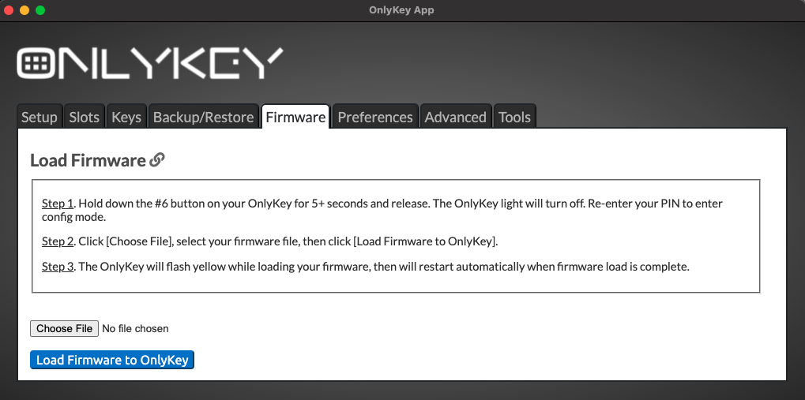

OnlyKey firmware 3.1.0 is now available, together with OnlyKey App 6.0.0, python-onlykey 1.3.1, onlykey-agent 1.1.17 and the new web app at [apps.onlykey.io](https://apps.onlykey.io). This guide walks through the upgrade step by step.

:::warning "⚠️ Back up first"
**Create a backup of your OnlyKey before you upgrade, and keep your backup key or passphrase where you can find it.** If anything goes wrong during the upgrade, the backup is how you get your slots and keys back.

- How to back up: [Secure Encrypted Backup](/usersguide#secure-encrypted-backup-anywhere) and [Restore From Backup](/usersguide#restore-from-backup) in the User's Guide
- The upgrade steps: [Steps to Upgrade](#steps-to-upgrade) below
- About the firmware: [OnlyKey Firmware](/firmware)
:::

## Why Upgrade?

**This release includes security fixes. We recommend that all OnlyKey users update.**

It also adds new features:

- **Post-quantum keys.** ML-KEM-768 and X-Wing keys, which OnlyKey can generate itself, and composite post-quantum PGP keys.
- **Derived X-Wing keys for age** file encryption.
- **A new web app at [apps.onlykey.io](https://apps.onlykey.io)** with an authenticated, encrypted connection between the browser and OnlyKey.
- **Webcrypt policy.** Choose whether the browser may use stored keys, derived keys only, or nothing.
- **Separate confirmation settings** for stored keys and derived keys: challenge code or button press.
- **Opt-in v2 derivation for SSH/GPG keys** with onlykey-agent. Your existing derived keys do not change.
- Fixes for confirmation timeouts, large responses, Windows browser logins and keyboard layouts.

## Before You Upgrade

:::note
Please read these before upgrading:

- **Web app:** firmware 3.1.0 uses [apps.onlykey.io](https://apps.onlykey.io). OnlyKeys on firmware 3.0.4 or older keep using apps.crp.to.
- **One firmware edition:** the International Travel Edition and plausible deniability mode have been removed in 3.1.0.
- **OnlyKey and OnlyKey DUO** use the same firmware file.
- **SSH/GPG derived keys** created with onlykey-agent stay the same after the upgrade.
- **python-onlykey 1.3.1** (onlykey-cli) needs Python 3.10 or newer.
:::

:::warning "⚠️ Warning"
If your OnlyKey has firmware v0.2-beta.8 or earlier you must back up OnlyKey before upgrading, and restore the backup file once the firmware is upgraded.
:::

## Steps to Upgrade {#steps-to-upgrade}

:::callout
**Step 1.** **Back up your OnlyKey** - Open the OnlyKey App, go to the Backup/Restore tab and create a backup. Make sure you have your backup key or passphrase. Full instructions are in the [User's Guide](/usersguide#backup-with-onlykey-app).
:::

:::callout
**Step 2.** **Install OnlyKey App 6.0.0** - Download it from the [OnlyKey App releases](https://github.com/trustcrypto/OnlyKey-App/releases/latest) or follow the instructions [here](/usersguide#app-desktop).
:::

:::callout
**Step 3.** **Upgrade the OnlyKey firmware** - Follow the instructions [below](#loading-onlykey-firmware).
:::

:::callout
**Step 4.** **Check your OnlyKey** - Unlock it with your PIN and confirm that your slots and keys are there. If anything is missing, restore your backup ([Restore From Backup](/usersguide#restore-from-backup)).
:::

:::callout
**Step 5.** **Update the command-line tools (if you use them)** - see below.
:::

:::note
**onlykey-cli and onlykey-agent users:** install the latest versions with `$ pip3 install --upgrade onlykey onlykey-agent`. Python 3.10 or newer is required.
:::

### Steps to Upgrade OnlyKey firmware {#loading-onlykey-firmware}

### Download Firmware {#download-firmware}

There is a tab named Firmware in the app. This is used to load the latest firmware onto OnlyKey directly through the OnlyKey app.

- Download <a href="https://github.com/trustcrypto/OnlyKey-Firmware/releases/download/v3.1.0-prod/Signed_OnlyKey_3_1_0_STD.txt" target="_blank" download="Signed_OnlyKey_3_1_0_STD.txt">OnlyKey firmware 3.1.0</a>
- Go to the Firmware tab in the app
- Follow the instructions in the app to load the firmware

:::note
You can ensure the integrity of your downloaded file by verifying the checksum.  Signed_OnlyKey_3_1_0_STD.txt SHA 256 checksum: 
TODO
:::

For more information on this release see the [OnlyKey firmware 3.1.0 release notes](https://github.com/trustcrypto/OnlyKey-Firmware/releases/tag/v3.1.0-prod).

<!---
Previous release (3.0.4):
- Download [OnlyKey Standard Edition firmware](https://github.com/trustcrypto/OnlyKey-Firmware/releases/download/v3.0.4-prod/Signed_OnlyKey_3_0_4_STD.txt)
- Signed_OnlyKey_3_0_4_STD.txt SHA 256 checksum: f895100a2f828b66ec5335fd676ef659daf87d51bfeecca5fb8bf9b7c8e259bd
-->
